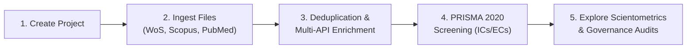

# UniDS Platform — Unified Decision Support Platform

<div align="center">


**An Open-Source, Decoupled Decision-Support Architecture for Systematic Literature Reviews (SLRs), High-Throughput Scientometrics, and Editorial Governance.**

Developed at the **BPM Research Lab — Institute of Informatics, Federal University of Rio Grande do Sul (UFRGS)**.

[English Documentation](#-english) • [Documentação em Português](#-português)

---

</div>

## 🌐 Language Navigation / Idioma
- [🇺🇸 English Documentation](#-english)
  - [Overview & Research Context](#-overview--research-context)
  - [Key Architectural Capabilities](#-key-architectural-capabilities)
  - [Directory Structure](#-directory-structure)
  - [Installation & Quickstart](#-installation--quickstart)
  - [Step-by-Step Usage Guide](#-step-by-step-usage-guide)
  - [Configuration & API Keys](#-configuration--api-keys)
  - [Ethical Considerations & Citation](#-ethical-considerations--citation)
- [🇧🇷 Documentação em Português](#-português)
  - [Visão Geral e Contexto de Pesquisa](#-visão-geral-e-contexto-de-pesquisa)
  - [Principais Funcionalidades](#-principais-funcionalidades)
  - [Guia de Instalação e Execução](#-guia-de-instalação-e-execução)
  - [Passo a Passo de Uso](#-passo-a-passo-de-uso)
  - [Ética e Citação](#-ética-e-citação)

---

# 🇺🇸 English

## 📌 Overview & Research Context

The **UniDS Platform** (*Unified Decision Support Platform*) is an enterprise-grade scientometric and evidence-synthesis environment engineered to bridge the gap between academic literature reviews and continuous journal governance. 

Originating from research initiated at the **BPM Research Lab (UFRGS)** by **Leticia Naomi Asano** and **Prof. Dr. Lucineia Heloisa Thom**, the platform has evolved from an initial prototype into a decoupled, highly extensible modular decision-support system. It addresses two interdependent workflows:
1. **For Researchers:** An end-to-end systematic literature review (SLR) pipeline featuring automated ingestion, multi-API metadata enrichment, fuzzy deduplication, an interactive **PRISMA 2020 state machine**, dual-model thematic clustering, and longitudinal flow modeling.
2. **For Journal Editorial Boards:** Real-time editorial governance diagnostics, including sub-second **institutional endogeneity audits ($E_{\text{inst}}$)** for indexing compliance (e.g., SciELO, Scopus), transnational co-authorship tracking, citation inequality evaluations (Gini coefficient), and intelligent reviewer matching.

---

## 🚀 Key Architectural Capabilities

### 1. Ingestion & Multi-Format Harmonization (`core/ingestion.py`)
- Natively ingests bibliographic exports from **Scopus**, **Web of Science (WoS)**, **PubMed**, **IEEE Xplore**, **ScienceDirect / Springer**, as well as generic **CSV**, **Excel (.xlsx)**, **BibTeX (.bib)**, and **RIS** formats.
- Employs dynamic column mapping and schema normalization to construct a unified internal data frame.

### 2. Multi-Tier Deduplication Engine (`core/deduplication.py`)
- **Tier 1:** Exact case-insensitive Digital Object Identifier (DOI) normalization and resolution.
- **Tier 2:** Normalized string matching using Levenshtein distance and Jaro-Winkler similarity on article titles.
- **Tier 3:** Cross-field metadata reconciliation, merging unique attributes from duplicate records to maximize metadata completeness before discarding redundancies.

### 3. Forensic Multi-API Enrichment Pipeline (`core/enrichment.py`)
- Implements a resilient tiered fallback architecture querying **OpenAlex**, **Crossref**, **PubMed (Entrez / E-Utilities)**, and **Semantic Scholar**.
- Automated 3-attempt exponential backoff retry loops to overcome API rate limits (`429`) and server timeouts (`503`).
- **Forensic Per-Record Audit Logs:** Generates interactive diagnostic reports showing exact API payloads, discrepancy resolutions (e.g., electronic vs. print publication years), and direct hyperlinked URLs to external accession records.

### 4. PRISMA 2020 Systematic Review State Machine (`features/prisma_assistant.py`)
- Replaces error-prone spreadsheet tracking with a formal, deterministic review state machine.
- Manages user-defined **Inclusion Criteria (ICs)** and **Exclusion Criteria (ECs)**.
- Renders and exports interactive, publication-ready **PRISMA 2020 flowcharts** (in SVG, HTML, and high-resolution image formats).
- Session persistence via `prisma_state.json` ensures full reproducibility across reloads.

### 5. Scientometric & Bibliometric Profiling (`dashboard/`)
- Computes classical bibliometric distributions: **Bradford's Law of Scattering** (Core vs. Peripheral sources), **Lotka's Law** of author scientific productivity, **Price's Aging Index**, and the Hirsch core ($h$-index).
- Evaluates citation inequality through the **Gini coefficient ($G$)** with Lorentz curves to detect hyper-concentrated citation distributions.

### 6. Interactive Network Science Mapping (`features/network_topology.py`)
- Visualizes interactive topological networks: **Co-authorship networks**, **Bibliographic Coupling (BC)**, **Co-citation analysis**, and **Co-word semantic networks**.
- Powered by bundled, zero-CDN JavaScript libraries (`lib/vis-9.1.2/`) to ensure full functionality in air-gapped or offline environments.

### 7. Thematic Stratification & Longitudinal Flow (`features/thematic_*`)
- **Dual-Ensemble Topic Modeling:** Combines dense neural sentence embeddings (**BERTopic**) with Dirichlet multinomial mixture modeling (**GSDMM**) optimized for short bibliographic abstracts.
- **Mega-Cluster Breakdown Engine:** Dynamically identifies overly generic clusters ($>40\%$ corpus concentration), freezing ubiquitous stopwords and recursively splitting topics into granular sub-disciplines.
- **Callon Strategic Diagram:** Automatically maps research themes into Motor, Basic, Emerging, and Isolated quadrants based on centrality and density.
- **Longitudinal Thematic Flow:** Alluvial Sankey diagrams trace the branching, consolidation, and drift of research paradigms across chronological eras.

### 8. GenAI Semantic Labeling Pipeline (`lib/topic_modeling/genai.py`)
- Bridges mathematical topic clusters with Large Language Models (**Google Gemini**, **Groq / LLaMA 3**, **OpenAI**, **Anthropic Claude**, and **local offline Ollama**).
- **Critical Guardrails Against Hallucination:** Constrains topic descriptors to established academic ontologies (e.g., MeSH, ACM Computing Classification System, IEEE Taxonomy), restricts naming to 2–3 words, and forbids speculative extrapolation.
- Deterministic low-temperature decoding ($T \le 0.1$) achieves $>90\%$ lexical stability across runs.

### 9. Editorial Governance & Compliance (`features/demographics.py`, `governance.py`)
- **Institutional Endogeneity Audit ($E_{\text{inst}}$):** Vectorized string search against host institution variants (e.g., "Universidade Federal do Rio Grande do Sul", "UFRGS", "Inst. de Informática"), calculating the percentage of internal publications in milliseconds to verify compliance with SciELO/Scopus indexation rules (threshold $< 20\%$).
- **Transnational Collaboration Reach:** Automatically maps geographic co-authorship diversity, identifying isolated vs. internationally connected publication nodes.
- **Demographic & Gender Diversity:** Prenome-based demographic inference with an ethical, mandatory `Undefined` category.
- **Automated Reviewer Matcher:** Synthesizes topic similarity vectors between submitted manuscripts and the historical author pool to suggest specialized peer reviewers.

---

## 📂 Directory Structure

```text
bibliographic-analysis-tool/
├── app.py                     # Main Streamlit orchestration entrypoint and routing
├── requirements.txt           # Python dependency specifications
│
├── core/                      # Data Ingestion, Deduplication, and Enrichment
│   ├── ingestion.py           # Multi-format intake (WoS, Scopus, PubMed, IEEE, CSV, BibTeX)
│   ├── deduplication.py       # Exact DOI & fuzzy title reconciliation engine
│   ├── enrichment.py          # Tiered OpenAlex / Crossref / PubMed / Semantic Scholar APIs
│   ├── export.py              # Export engine (Excel, CSV, Clean Master Datasets)
│   └── main.py                # Core Data Prep view & diagnostics panel
│
├── dashboard/                 # Bibliometrics & Scientometric Visualization
│   ├── articles_explorer.py   # Interactive searchable metadata table with direct DOI links
│   ├── metrics_general.py     # Production volume, Bradford's Law, Lotka's Law
│   ├── metrics_impact.py      # Citation distribution, Gini coefficient (G), h-index
│   ├── metrics_aging.py       # Price's Index, obsolescence rate, temporal half-life
│   └── main.py                # Dashboard routing & profile context switch
│
├── features/                  # Advanced Scientometric & Reviewer Engines
│   ├── prisma_assistant.py    # PRISMA 2020 State Machine & interactive flowchart builder
│   ├── network_topology.py    # Bibliographic coupling, co-citation, and co-authorship graphs
│   ├── thematic_stratification.py # BERTopic + GSDMM clustering & Callon strategic diagrams
│   ├── thematic_flow.py       # Longitudinal alluvial Sankey diagram across chronological eras
│   ├── demographics.py        # Geographic distribution & transnational network analysis
│   ├── gender.py              # Demographic & gender balance mapping (with 'Undefined' state)
│   └── reviewer_matcher.py    # Automated manuscript-to-reviewer matching engine
│
├── lib/                       # Foundational Algorithmic Core & Bundled Assets
│   ├── topic_modeling/        # Decoupled NLP core
│   │   ├── genai.py           # LLM topic naming with strict ontological guardrails
│   │   ├── alignment.py       # Jaccard consensus alignment between BERTopic & GSDMM
│   │   ├── ensemble.py        # Dual-clustering orchestration
│   │   ├── gsdmm_mgp.py       # Modified Gibbs Sampling for Dirichlet Multinomial Mixture
│   │   └── metrics.py         # Topic coherence (NPMI, C_V) and quality metrics
│   ├── vis-9.1.2/             # Localized Vis.js library for offline network rendering
│   └── tom-select/            # Localized responsive multi-select UI components
│
├── Projects/                  # Isolated project workspaces (created dynamically)
│   └── <Project_Name>/        # Contains master_dataset.csv, prisma_state.json, and audit logs
│
└── utils/                     # Formatting, styling, and workspace manager
    ├── project_manager.py     # Multi-project isolation and persistence logic
    ├── formatters.py          # Numeric, temporal, and string sanitizers
    ├── exports.py             # High-resolution image and vector download wrappers
    └── style.py               # Custom CSS injection and responsive styling
```

---

## 🛠️ Installation & Quickstart

### Prerequisites
- **Python 3.10+** (Python 3.11 or 3.12 recommended)
- Git installed on your system

### 1. Clone the Repository
```bash
git clone https://github.com/bpm-research-lab/bibliographic-analysis-tool.git
cd bibliographic-analysis-tool
```

### 2. Create and Activate a Virtual Environment
```bash
# On Linux / macOS:
python3 -m venv venv
source venv/bin/activate

# On Windows (PowerShell):
python -m venv venv
.\venv\Scripts\Activate.ps1
```

### 3. Install Dependencies
```bash
pip install --upgrade pip
pip install -r requirements.txt
```

### 4. Launch the Platform
```bash
streamlit run app.py
```
The application will automatically launch in your default web browser at **`http://localhost:8501/`**.

---

## 📖 Step-by-Step Usage Guide



### Step 1: Manage Projects
- On initial launch, name your workspace under **Active Project** (e.g., `Review_AI_Healthcare`). All cleaned datasets, PRISMA states, and audit logs are safely isolated in `Projects/<Project_Name>/`.

### Step 2: Data Intake & Normalization
- Navigate to the **Core Data Prep** view.
- Upload raw bibliographic files (`.csv`, `.xlsx`, `.bib`, `.ris`, or `.txt`).
- Confirm column mappings or allow the auto-detection engine to map standard fields (`Title`, `DOI`, `Authors`, `Publication Year`, `Abstract`, `Times Cited`).

### Step 3: Deduplication & Multi-API Enrichment
- Click **Run Deduplication** to eliminate duplicate records using DOI matching and fuzzy title analysis.
- (Optional) Click **Run Metadata Enrichment** to query OpenAlex, Crossref, and PubMed. The system will recover missing DOIs, expand author names, fetch abstracts, and fill missing citation counts.
- Inspect the **Forensic Per-Record Audit Logs** to trace the provenance and recovery source of every individual record.

### Step 4: Systematic Screening with PRISMA Assistant
- Switch to the **PRISMA Assistant** tab.
- Define your custom **Inclusion Criteria (ICs)** and **Exclusion Criteria (ECs)**.
- Interactively screen candidates: assign criteria reasons to excluded articles.
- The platform dynamically renders the official **PRISMA 2020 Flowchart**. Click **Export Flowchart** to download high-resolution SVG/PNG diagrams.

### Step 5: Advanced Scientometrics & Editorial Audits
Use the left sidebar navigation to explore analytical modules:
- **Articles Explorer:** Search, filter, and inspect individual records with clickable DOIs.
- **Main Dashboard:** Examine Bradford's zones, Lotka's productivity curve, and the Gini citation inequality metric.
- **Thematic Stratification & Flow:** Uncover emerging research paradigms, inspect Callon strategic diagrams, and trace longitudinal thematic evolution across eras.
- **Demographics & Governance:** Run the instant Institutional Endogeneity audit ($E_{\text{inst}}$) and evaluate international co-authorship networks.

---

## 🔑 Configuration & API Keys

The platform functions fully **out-of-the-box without requiring mandatory API keys**. OpenAlex, Crossref, and PubMed E-Utilities operate via public academic endpoints.

### Optional: GenAI LLM Semantic Labeling
To enable automated GenAI topic labeling in `features/thematic_stratification.py`:
1. Provide an API key directly in the UI configuration drawer for:
   - **Google Gemini** (Free tier available at Google AI Studio)
   - **Groq Cloud** (Ultra-fast LLaMA 3 inference at console.groq.com)
   - **OpenAI** (GPT-4o mini)
   - **Anthropic Claude**
2. **100% Offline / Local Operation:** Select **Ollama (Local)** to run local models (e.g., `llama3`, `mistral`, `phi3`) with zero external network connectivity.

---

## ⚖️ Ethical Considerations & Citation

### Ethical Demographics and Fair Use
- **Demographic Inference:** Author gender and demographic estimations are probabilistic and intended exclusively for aggregate diversity auditing. An ethical **Undefined** category is strictly enforced to prevent misclassification.
- **Fair Use:** This tool is designed strictly for academic, educational, and research evaluation. Please observe data provider terms of service (OpenAlex, Crossref, PubMed) when executing batch queries.

### Academic Citation
If you utilize this platform, its algorithms, or generated visualizations in your published research, please cite:

```bibtex
@article{unids_platform_2026,
  author    = {Asano, Leticia Naomi and Thom, Lucineia Heloisa},
  title     = {UniDS Platform: A Decoupled Decision-Support Architecture for Systematic Literature Reviews and Scientometric Editorial Governance},
  journal   = {IEEE Access},
  year      = {2026},
  note      = {BPM Research Lab, Institute of Informatics, Federal University of Rio Grande do Sul (UFRGS)}
}
```

---

# 🇧🇷 Português

## 📌 Visão Geral e Contexto de Pesquisa

A **UniDS Platform** (*Unified Decision Support Platform*) é uma plataforma científica de apoio à decisão para revisões sistemáticas da literatura (RSL) e governança editorial de periódicos acadêmicos.

Desenvolvida no âmbito do **BPM Research Lab** do Instituto de Informática da **Universidade Federal do Rio Grande do Sul (UFRGS)**, a ferramenta originou-se das pesquisas de **Leticia Naomi Asano** sob orientação da **Profa. Dra. Lucineia Heloisa Thom**, evoluindo de um protótipo inicial para uma arquitetura modular corporativa desacoplada.

A plataforma atende a dois perfis principais:
1. **Pesquisadores:** Condução completa de revisões sistemáticas da literatura com suporte ao padrão **PRISMA 2020**, enriquecimento via múltiplas APIs (OpenAlex, Crossref, PubMed, Semantic Scholar), desduplicação fuzzy e modelagem de tópicos neurais e probabilísticos.
2. **Corpos Editoriais:** Diagnóstico de saúde do periódico em tempo real, incluindo auditoria imediata de **endogenia institucional ($E_{\text{inst}}$)** para conformidade com indexadores (SciELO, Scopus), cálculo de desigualdade de citações (Gini), mapeamento transnacional e recomendação inteligente de revisores.

---

## 🚀 Principais Funcionalidades

- **Ingestão Universal:** Suporte a arquivos exportados de Scopus, Web of Science, PubMed, IEEE Xplore, ScienceDirect/Springer, além de formatos CSV, Excel, BibTeX e RIS.
- **Desduplicação em Múltiplos Níveis:** Resolução exata por DOI e correspondência difusa por título (Levenshtein e Jaro-Winkler) com preservação e fusão de metadados.
- **Enriquecimento Resiliente:** Pipeline com fallback automático entre OpenAlex, Crossref e PubMed, com proteção contra limites de requisição (*exponential backoff retry loops*) e logs forenses por registro com links diretos.
- **Assistente PRISMA 2020:** Máquina de estados para triagem interativa com critérios de inclusão/exclusão (ICs/ECs), persistência em `prisma_state.json` e exportação vetorial de fluxogramas.
- **Perfilagem Bibliométrica:** Zonas de Bradford, produtividade de Lotka, índice de obsolescência de Price e cálculo do coeficiente de Gini ($G$) sobre citações.
- **Mapeamento Topológico Offline:** Redes de coautoria, acoplamento bibliográfico e cocitação renderizadas via Vis.js 100% local (sem dependência de CDNs externas).
- **Estratificação e Fluxo Temático:** Conjunto dual BERTopic + GSDMM com particionamento automático de megaclusters, Diagrama Estratégico de Callon e Diagrama de Sankey aluvial temporal.
- **Rotulagem com GenAI Confiável:** Suporte a Gemini, LLaMA 3 (Groq), OpenAI, Claude e Ollama local com regras estritas de prompt ancoradas em ontologias acadêmicas (MeSH, ACM CCS) e baixa temperatura determinística ($T \le 0{,}1$).
- **Governança Editorial:** Auditoria instantânea de endogenia institucional ($E_{\text{inst}}$), diversidade demográfica ética e recomendador de revisores.

---

## 🛠️ Guia de Instalação e Execução

### Requisitos Prévios
- Python 3.10 ou superior instalado.
- Gerenciador de pacotes `pip` e Git.

### 1. Clonar o Repositório
```bash
git clone https://github.com/bpm-research-lab/bibliographic-analysis-tool.git
cd bibliographic-analysis-tool
```

### 2. Criar Ambiente Virtual
```bash
# No Windows (PowerShell):
python -m venv venv
.\venv\Scripts\Activate.ps1

# No Linux / macOS:
python3 -m venv venv
source venv/bin/activate
```

### 3. Instalar Dependências
```bash
pip install -r requirements.txt
```

### 4. Iniciar a Aplicação
```bash
streamlit run app.py
```
O navegador abrirá automaticamente em **`http://localhost:8501/`**.

---

## 📖 Passo a Passo de Uso

1. **Gestão de Projetos:** Defina o nome do projeto no menu lateral (ex: `Revisao_RITA_2026`). Seus dados brutos, triagens e logs ficarão isolados na pasta `Projects/<NomeDoProjeto>/`.
2. **Importação de Dados:** Na aba **Core Data Prep**, faça o upload da sua planilha ou arquivo de citações. O sistema mapeará as colunas automaticamente.
3. **Desduplicação e Enriquecimento:** Execute a limpeza para remover duplicatas e acione o enriquecimento via APIs externas para recuperar resumos, afiliações e datas completas.
4. **Triagem Sistemática (PRISMA):** Acesse a aba **PRISMA Assistant**, cadastre seus critérios de inclusão e exclusão e realize a seleção dos artigos. Exporte o fluxograma oficial PRISMA 2020 em alta resolução.
5. **Análises Cientométricas e Governança:** Navegue pelos módulos de **Articles Explorer**, **Main Dashboard**, **Topologia de Redes**, **Estratificação Temática** e **Demografia & Governança**.

---

## ⚖️ Licença, Ética e Agradecimentos

Este software é disponibilizado para fins de pesquisa acadêmica e educação sob licença de código aberto. 

- **Afiliação:** BPM Research Lab — Instituto de Informática, Universidade Federal do Rio Grande do Sul (UFRGS).
- **Coordenação:** Profa. Dra. Lucineia Heloisa Thom (`lucineia@inf.ufrgs.br`)
- **Laboratório:** [https://www.ufrgs.br/bpmlab/](https://www.ufrgs.br/bpmlab/) | Instagram: `@bpm_research_lab_ufrgs`

Ao utilizar esta ferramenta ou seus resultados em artigos e dissertações, solicite e inclua a citação ao projeto e ao BPM Research Lab – UFRGS.
